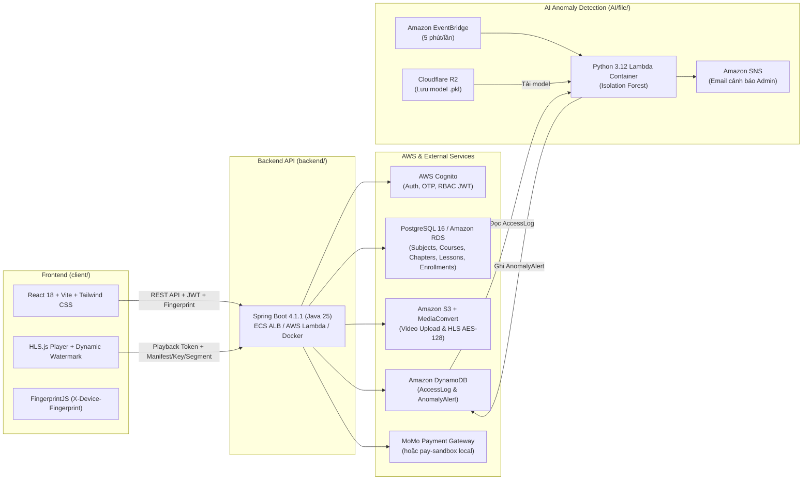

# SecureLearn — Nền Tảng Học Trực Tuyến Bảo Vệ Bản Quyền Video & Phát Hiện Bất Thường Bằng AI

**SecureLearn** là hệ thống quản lý học tập trực tuyến (LMS) được thiết kế chuyên biệt để **bảo vệ bản quyền video bài giảng** và **phát hiện hành vi gian lận / rò rỉ nội dung bằng AI**. Dự án kết hợp kiến trúc Cloud-Native trên AWS (Cognito, S3, MediaConvert, RDS PostgreSQL, DynamoDB, Lambda/ECS, EventBridge, SNS) với giao diện hiện đại hỗ trợ đa ngôn ngữ (`VI` / `EN`) và chế độ Sáng/Tối (`Light` / `Dark`).

---

## Mục Lục

1. [Kiến Trúc Hệ Thống](#1-kiến-trúc-hệ-thống)
2. [Công Nghệ Sử Dụng](#2-công-nghệ-sử-dụng)
3. [Tính Năng Chính Theo Vai Trò](#3-tính-năng-chính-theo-vai-trò)
4. [Cơ Chế Bảo Mật & Chống Rò Rỉ Nội Dung](#4-cơ-chế-bảo-mật--chống-rò-rỉ-nội-dung)
5. [Cấu Trúc Thư Mục Dự Án](#5-cấu-trúc-thư-mục-dự-án)
6. [Tổng Hợp API Chính](#6-tổng-hợp-api-chính)
7. [Hướng Dẫn Cài Đặt & Chạy Dự Án](#7-hướng-dẫn-cài-đặt--chạy-dự-án)
8. [Triển Khai Cloud & AI Pipeline](#8-triển-khai-cloud--ai-pipeline)

---

## 1. Kiến Trúc Hệ Thống



---

## 2. Công Nghệ Sử Dụng

| Phân hệ | Công nghệ & Thư viện |
|---|---|
| **Frontend (`client/`)** | React 18.3, Vite 5.4, React Router 7, Tailwind CSS 3.4, Lucide Icons, Framer Motion, Axios, `hls.js` 1.5, `@fingerprintjs/fingerprintjs` 5.3, `i18next` / `react-i18next` (VI/EN), Nginx (Docker) |
| **Backend (`backend/`)** | Java 25, Spring Boot 4.1.1, Spring Security & OAuth2 Resource Server (JWT), Spring Data JPA, Spring Cloud AWS 4.1.1 (S3, DynamoDB), AWS SDK v2 (Cognito IDP, MediaConvert), PostgreSQL 16, Maven |
| **AI Anomaly Detection (`AI/file/`)** | Python 3.12, `scikit-learn` 1.9.1 (Isolation Forest), `numpy`, `pandas`, `joblib`, `boto3`, AWS Lambda Container Image (ECR), Cloudflare R2, EventBridge, SNS |
| **Triển khai & DevOps** | Docker & Docker Compose, AWS SAM (`backend/template.yaml`), AWS ECS Fargate + ALB (`backend/ecs-template.yaml`), Vercel (`client/vercel.json`) |

---

## 3. Tính Năng Chính Theo Vai Trò

### Khách truy cập (Guest)
- **Trang chủ & Giới thiệu nền tảng**: Hiển thị danh sách khóa học nổi bật, lộ trình học tập, đánh giá học viên và đăng ký nhận thông báo.
- **Danh mục Môn học & Khóa học**: Tìm kiếm theo từ khóa, lọc trực tiếp theo **Môn học (`Subject`)**, xem chi tiết khóa học, chương và danh sách bài giảng.
- **Xác thực tài khoản**: Đăng ký học viên kèm xác thực **OTP qua Email**, đăng nhập, quên mật khẩu và tự động làm mới token (`refresh token`).

### Học viên (Student)
- **Đăng ký & Thanh toán khóa học**: Hỗ trợ thanh toán qua cổng **MoMo** (hoặc `pay-sandbox` khi chạy cục bộ), tự động xác nhận quyền học (`GET /api/v1/enrollment/me`).
- **Không gian học tập (`StudentCoursePlayer`)**:
  - Xem video HLS mã hóa AES-128 mượt mà với **Watermark động** hiển thị thông tin tài khoản chống quay màn hình.
  - Điều hướng chương/bài giảng dạng Accordion, chuyển bài trước/tiếp theo.
  - **Ghi chú bài giảng cá nhân** (tự động đồng bộ với Backend hoặc lưu dự phòng theo từng bài học trên `localStorage`).
- **Quản lý Hồ sơ & Mật khẩu**: Xem thông tin tài khoản, cập nhật tên hiển thị (`POST /api/v1/auth/update`) và đổi mật khẩu (`POST /api/v1/auth/password`).

### Giảng viên (Instructor)
- **Quản lý Khóa học & Bài giảng (`InstructorVideos`)**:
  - Chỉ hiển thị và quản lý các khóa học do chính giảng viên tạo thông qua `GET /api/v1/courses`.
  - Tạo/cập nhật/xóa Môn học, Khóa học, Chương (`Chapter`) và Bài học (`Lesson`).
- **Đăng tải & Thay thế Video (`UploadVideo`, `ReuploadVideoModal`)**:
  - Quy trình tải video 3 bước: xin Presigned URL (`POST /api/v1/upload/presign`) → đẩy thẳng file lên S3 → kích hoạt xử lý HLS (`POST /api/v1/upload/process`).
  - Hỗ trợ thay thế/tải lại video cho bài giảng đã có mà không làm mất cấu trúc khóa học.
- **Xem trước bài giảng (`InstructorVideoPreview`)**: Kiểm tra trình phát và nội dung các khóa học của chính mình.

### Quản trị viên (Administrator)
- **Bảng cảnh báo bất thường AI (`AdminAnomalyDashboard`)**:
  - Theo dõi nhật ký truy cập (`GET /api/v1/admin/logs`) và cảnh báo từ mô hình **Isolation Forest** (`GET /api/v1/admin/alerts`).
  - Hiển thị điểm bất thường (`score`), trạng thái (`OPEN`/`RESOLVED`) và các đặc trưng hành vi chính (`totalRequests`, `avgDownloadInterval`, `sequentialRatio`, `coverageRatio`, `uniqueIpCount`, `uniqueDeviceCount`).
- **Quản lý Người dùng (`AdminUserManagement`)**: Xem danh sách tài khoản AWS Cognito, phân quyền, tạo tài khoản Giảng viên/Admin và xóa người dùng.
- **Truy vết Watermark (`LeakTracing`)**: Tra cứu và đối soát dấu vân tay/thông tin tài khoản khi phát hiện video rò rỉ.

### Trải nghiệm người dùng (UX/UI)
- Đa ngôn ngữ **Tiếng Việt / Tiếng Anh** qua tiền tố URL (`/:lang/...`).
- Chế độ **Sáng / Tối (`Light` / `Dark`)** đồng bộ toàn bộ trang.
- Chuẩn khả năng tiếp cận **WCAG 2.1 AA** (focus bàn phím, skip-to-content, aria-labels, nút ẩn/hiện mật khẩu, khung Skeleton khi tải dữ liệu).
- Tách gói tải theo route (**Code-Splitting** với `React.lazy` & `Suspense`) giúp giảm hơn 60% dung lượng JS tải lần đầu.

---

## 4. Cơ Chế Bảo Mật & Chống Rò Rỉ Nội Dung

1. **Xác thực & Phân quyền (AWS Cognito + RBAC)**: Sử dụng JWT Bearer Token cấp bởi AWS Cognito, phân quyền chặt chẽ theo nhóm `ADMIN`, `INSTRUCTOR`, `STUDENT` trên cả Backend và `ProtectedRoute` ở Frontend.
2. **Định danh thiết bị (`X-Device-Fingerprint`)**: Mọi request từ `axiosClient` đều tự động đính kèm dấu vân tay trình duyệt (`FingerprintJS`) để ghi log và phát hiện chia sẻ tài khoản.
3. **Phát video HLS bảo mật (AES-128 + Signed Playback Token)**: Video được mã hóa thành từng phân đoạn `.ts` kèm khóa AES-128. Trình phát phải xin phiên phát (`POST /api/v1/lesson/{id}/playback`) để lấy token HMAC có thời hạn ngắn trước khi tải manifest, key và segment.
4. **Dynamic Watermark & Truy vết rò rỉ**: Lớp phủ watermark động hiển thị thông tin người xem di chuyển trên khung video giúp ngăn chặn quay màn hình và hỗ trợ truy vết nguồn phát tán.
5. **Phát hiện hành vi bất thường bằng AI (Isolation Forest)**: Lambda định kỳ mỗi 5 phút phân tích `AccessLog` trong DynamoDB để phát hiện bot/crawler tải hàng loạt hoặc chia sẻ tài khoản đa IP/đa thiết bị, tự động ghi `AnomalyAlert` và gửi email qua Amazon SNS.

---

## 5. Cấu Trúc Thư Mục Dự Án

```text
SecureLearn/
├── client/                         # Frontend (React 18 + Vite + Tailwind CSS)
│   ├── public/                     # Static assets & favicon
│   ├── src/
│   │   ├── api/                    # apiConfig.js (routing Lambda/ALB), axiosClient.js (JWT + Fingerprint + Auto Refresh)
│   │   ├── components/             # SecureVideoPlayer, UploadVideo, ReuploadVideoModal, AdminAnomalyDashboard, Layout...
│   │   ├── context/                # AuthContext, ThemeContext, ToastContext
│   │   ├── hooks/                  # useSecureHls, useVideoUpload
│   │   ├── locales/                # Bản dịch đa ngôn ngữ (vi/translation.json, en/translation.json)
│   │   ├── pages/                  # Home, CourseCatalog, SubjectLectures, Login, Register, MyCourses,
│   │   │                           # StudentCoursePlayer, InstructorVideos, InstructorVideoPreview,
│   │   │                           # AdminUserManagement, LeakTracing, UserProfile...
│   │   └── services/               # authService, courseService, subjectService, entitlementService,
│   │                               # playbackService, uploadService, adminService, fingerprintService
│   ├── .env / .env.example         # Biến môi trường Frontend
│   ├── Dockerfile & nginx.conf     # Đóng gói container Nginx phục vụ SPA
│   ├── run.bat                     # Script build & chạy nhanh Docker container Frontend (port 3000)
│   └── vercel.json                 # Cấu hình rewrite SPA cho Vercel
│
├── backend/                        # Backend (Java 25 + Spring Boot 4.1.1)
│   ├── src/main/java/FCAJ/SecureLearn/
│   │   ├── Controller/             # AuthController, AdminController, CourseController, SubjectController,
│   │   │                           # EnrollmentController, PaymentController, PlaybackController,
│   │   │                           # UploadController, AIController
│   │   ├── Service/                # Nghiệp vụ Cognito, Course/Chapter/Lesson, S3/MediaConvert, MoMo, Playback
│   │   ├── Model/ & Repository/    # Entity JPA (PostgreSQL) & DynamoDB
│   │   └── Configuration/          # Spring Security, JWT, CORS, LogInterceptor (@LogAnnotationClass)
│   ├── db/                         # SQL migration scripts
│   ├── docker-compose.yml          # Khởi chạy PostgreSQL 16 + Backend + paySandbox (MoMo local)
│   ├── template.yaml               # AWS SAM template (triển khai phân tách theo nhóm AWS Lambda)
│   ├── ecs-template.yaml           # CloudFormation template triển khai AWS ECS Fargate + ALB
│   ├── start.bat / stop.bat        # Script bật/tắt nhanh stack Backend cục bộ trên Windows
│   └── .env.example                # Mẫu biến môi trường Backend
│
├── AI/file/                        # Module AI Anomaly Detection (AWS Lambda Container)
│   ├── handler.py                  # Đọc DynamoDB AccessLog -> trích xuất 12 features -> Isolation Forest -> Alert + SNS
│   ├── Dockerfile                  # Container Python 3.12 cho AWS Lambda
│   ├── requirements.txt            # scikit-learn, numpy, pandas, joblib
│   ├── seed_test_logs.py           # Script tạo log kiểm thử (normal / crawler / account sharing)
│   └── README.md                   # Hướng dẫn chi tiết 9 bước triển khai AI Lambda lên AWS
│
├── docs/                           # Tài liệu API Reference (.docx)
├── DATABASE_SCHEMA.md              # Đặc tả lược đồ cơ sở dữ liệu
├── LAMBDA_MIGRATION_TODO.md        # Theo dõi lộ trình tách dịch vụ lên AWS Lambda
└── README.md                       # Tài liệu tổng quan dự án (file này)
```

---

## 6. Tổng Hợp API Chính

Base path mặc định: `/api/v1`

### Xác thực & Tài khoản (`AuthController`)
| Method | Endpoint | Mô tả |
|---|---|---|
| `POST` | `/api/v1/auth/register` | Đăng ký tài khoản học viên & gửi mã OTP qua email |
| `POST` | `/api/v1/auth/verify` | Xác thực mã OTP kích hoạt tài khoản |
| `POST` | `/api/v1/auth/login` | Đăng nhập, trả về `accessToken`, `idToken`, `refreshToken` |
| `POST` | `/api/v1/auth/refresh` | Làm mới `accessToken` khi hết hạn |
| `GET` | `/api/v1/auth/me` | Lấy thông tin người dùng & danh sách vai trò từ JWT |
| `POST` | `/api/v1/auth/update` | Cập nhật tên hiển thị người dùng |
| `POST` | `/api/v1/auth/password` | Đổi mật khẩu tài khoản hiện tại |
| `POST` | `/api/v1/auth/logout` | Đăng xuất phiên làm việc (Cognito GlobalSignOut) |

### Môn học, Khóa học, Chương & Bài học (`SubjectController`, `CourseController`)
| Method | Endpoint | Mô tả |
|---|---|---|
| `GET` / `POST` / `DELETE` | `/api/v1/subject` | Lấy danh sách, tạo mới và xóa môn học |
| `GET` | `/api/v1/allcourses` | Lấy toàn bộ khóa học công khai (Catalog / Home) |
| `GET` | `/api/v1/courses` | Lấy danh sách khóa học do **Giảng viên đang đăng nhập** tạo |
| `GET` | `/api/v1/course/search?title=` | Tìm kiếm khóa học theo tiêu đề |
| `POST` / `PUT` / `DELETE` | `/api/v1/course[/{id}]` | Tạo mới, cập nhật và xóa khóa học |
| `GET` | `/api/v1/course/{courseId}/chapters` | Lấy danh sách chương của một khóa học |
| `POST` / `PUT` / `DELETE` | `/api/v1/chapter[/{id}]` | Tạo mới, cập nhật và xóa chương |
| `GET` | `/api/v1/chapter/{chapterId}/lessons` | Lấy danh sách bài học trong chương |
| `GET` / `POST` / `PUT` / `DELETE` | `/api/v1/lesson[/{id}]` | Xem chi tiết, tạo, cập nhật và xóa bài học |

### Đăng tải Video, Phát HLS & Thanh toán (`UploadController`, `PlaybackController`, `EnrollmentController`, `PaymentController`)
| Method | Endpoint | Mô tả |
|---|---|---|
| `POST` | `/api/v1/upload/presign` | Tạo Presigned URL đẩy video trực tiếp lên S3 |
| `POST` | `/api/v1/upload/process` | Kích hoạt đóng gói/mã hóa HLS AES-128 cho bài học |
| `POST` | `/api/v1/lesson/{id}/playback` | Cấp phiên phát & Signed Playback Token |
| `GET` | `/api/v1/lesson/{id}/manifest` | Trả về HLS `.m3u8` đã gắn token bảo mật |
| `GET` | `/api/v1/lesson/{id}/key` | Trả về khóa giải mã AES-128 hợp lệ cho phiên học |
| `GET` | `/api/v1/lesson/{id}/segment/{name}` | Stream phân đoạn `.ts` |
| `GET` | `/api/v1/enrollment/me` | Lấy danh sách khóa học học viên đã đăng ký |
| `POST` | `/api/v1/enrollment/{courseId}` | Khởi tạo đăng ký & thanh toán MoMo cho khóa học |

### Quản trị & Cảnh báo AI (`AdminController`, `AIController`)
| Method | Endpoint | Mô tả |
|---|---|---|
| `GET` / `POST` / `DELETE` | `/api/v1/admin/user*` | Quản lý danh sách, tạo và xóa người dùng Cognito |
| `GET` | `/api/v1/admin/logs` | Lấy nhật ký truy cập (`AccessLog`) từ DynamoDB |
| `GET` | `/api/v1/admin/alerts` | Lấy danh sách cảnh báo bất thường (`AnomalyAlert`) từ mô hình Isolation Forest |

---

## 7. Hướng Dẫn Cài Đặt & Chạy Dự Án

### Yêu cầu môi trường
- **Node.js** `>= 20` và `npm`
- **Docker Desktop** (khuyến nghị để chạy Backend + PostgreSQL + `paySandbox` chỉ với 1 lệnh)
- *(Tùy chọn nếu chạy Backend không qua Docker)*: **Java 25** và **Maven**

---

### A. Khởi chạy Backend (`backend/`)

1. Tạo file môi trường từ file mẫu:
   ```bash
   cd backend
   copy .env.example .env
   ```
2. Điền các giá trị thực tế vào `backend/.env` (`POSTGRES_PASSWORD`, `COGNITO_CLIENT_SECRET`, `COGNITO_POOL_ID`, `AWS_ACCESS_KEY_ID`, `AWS_SECRET_ACCESS_KEY`, `S3_BUCKET_NAME`, `PLAYBACK_TOKEN_SECRET`).
3. Khởi chạy toàn bộ stack (PostgreSQL 16 + Spring Boot Backend + MoMo `paySandbox`):
   - **Windows**: Chạy trực tiếp `backend\start.bat` (dừng bằng `backend\stop.bat`).
   - **Hoặc dùng Docker Compose**:
     ```bash
     docker compose up --build -d
     ```
4. Backend mặc định chạy tại: `http://localhost:8080/api/v1`

---

### B. Khởi chạy Frontend (`client/`)

#### Cách 1: Chạy môi trường phát triển (Vite Dev Server)
1. Kiểm tra và cấu hình `client/.env`:
   ```env
   VITE_API_URL=http://localhost:8080/api/v1
   VITE_LAMBDA_API_URL=http://localhost:8080/api/v1
   ```
   *(Hoặc trỏ tới URL ALB / AWS API Gateway nếu kết nối trực tiếp tới môi trường Cloud).*
2. Cài đặt thư viện và khởi chạy:
   ```bash
   cd client
   npm install
   npm run dev
   ```
3. Mở trình duyệt tại `http://localhost:5173` (tự động chuyển hướng sang `/vi/home`).

#### Cách 2: Build & chạy bằng Docker (Nginx — Production)
- Chỉnh `API_URL` và `LAMBDA_API_URL` trong `client/run.bat`, sau đó chạy:
  ```bat
  cd client
  run.bat
  ```
- Giao diện sẽ phục vụ qua Nginx tại `http://localhost:3000`.

#### Build kiểm tra Production
```bash
npm --prefix client run build
```

---

## 8. Triển Khai Cloud & AI Pipeline

- **Backend trên AWS Lambda (SAM)**: Xem cấu hình các nhóm hàm (`AccountFunction`, `AdminFunction`, `CourseFunction`, `PlaybackFunction`, `UploadFunction`) trong [backend/template.yaml](backend/template.yaml).
- **Backend trên AWS ECS Fargate + ALB**: Xem mẫu CloudFormation trong [backend/ecs-template.yaml](backend/ecs-template.yaml).
- **AI Anomaly Detection (Isolation Forest Lambda)**: Xem hướng dẫn triển khai chi tiết 9 bước (Cloudflare R2 → Secrets Manager → DynamoDB → SNS → ECR → Lambda → EventBridge) trong [AI/file/README.md](AI/file/README.md).
- **Lược đồ cơ sở dữ liệu**: Xem chi tiết tại [DATABASE_SCHEMA.md](DATABASE_SCHEMA.md).
