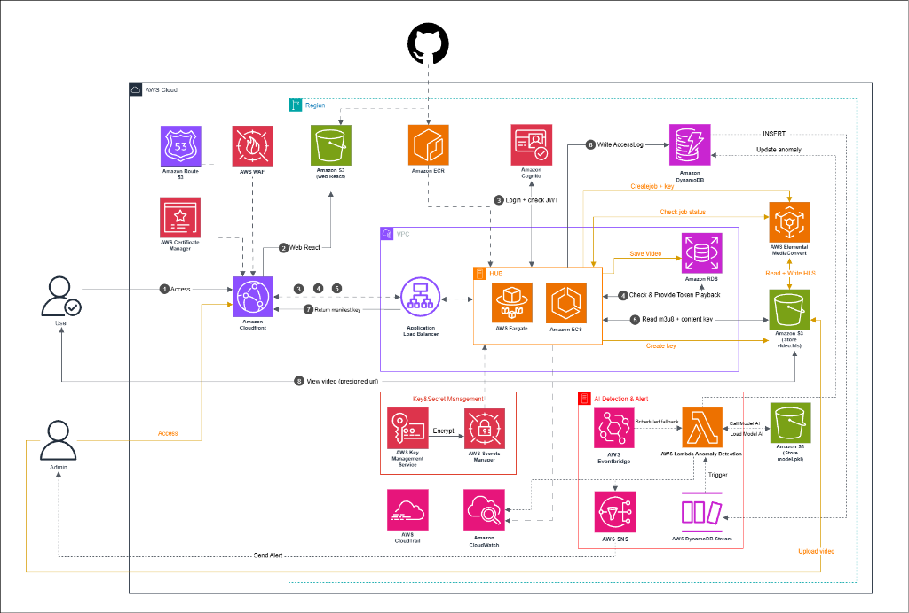

# SecureLearn — DRM-Protected Online Learning Platform with AI Anomaly Detection

**SecureLearn** is a cloud-native Learning Management System (LMS) built to **protect copyrighted video lectures** and **detect abnormal access or content-leakage behavior using AI**. Powered by AWS (CloudFront, WAF, Cognito, ECS Fargate + ALB, RDS PostgreSQL, S3, Elemental MediaConvert, DynamoDB, KMS, Secrets Manager, EventBridge, Lambda, SNS) and a modern bilingual (`EN` / `VI`) React web application with Light & Dark themes.

---

## Table of Contents

1. [System Architecture](#1-system-architecture)
2. [Tech Stack](#2-tech-stack)
3. [Key Features by Role](#3-key-features-by-role)
4. [Security & Anti-Piracy Layers](#4-security--anti-piracy-layers)
5. [Repository Structure](#5-repository-structure)
6. [API Reference Summary](#6-api-reference-summary)
7. [Local Setup & Running](#7-local-setup--running)
8. [Cloud & AI Pipeline Deployment](#8-cloud--ai-pipeline-deployment)

---

## 1. System Architecture



### End-to-End Request & Security Flows
1. **Edge & Web Delivery**: Users access SecureLearn through **Amazon Route 53**, **AWS Certificate Manager (ACM)**, **AWS WAF**, and **Amazon CloudFront**, which serves the React SPA hosted on **Amazon S3** and proxies API traffic to the backend.
2. **Authentication & RBAC**: Requests reach the **Application Load Balancer (ALB)** and **Spring Boot backend running on AWS Fargate / Amazon ECS** (images stored in **Amazon ECR**). User authentication, OTP verification, and role-based JWT validation (`ADMIN`, `INSTRUCTOR`, `STUDENT`) are handled via **Amazon Cognito**.
3. **Video Upload & HLS Encryption**: Instructors upload lecture videos to **Amazon S3** via presigned URLs. The backend triggers **AWS Elemental MediaConvert** to transcode videos into **HLS AES-128** encrypted segments (`.m3u8`, `.ts`, and `content.key`) and saves course metadata in **Amazon RDS (PostgreSQL)**.
4. **Secure Playback**: When an enrolled student plays a lesson, the backend verifies entitlement, issues a short-lived signed playback token, serves the manifest & decryption key, and streams segments from **Amazon S3** while logging every access event to **Amazon DynamoDB (`AccessLog`)**.
5. **AI Anomaly Detection & Alerting**: **Amazon DynamoDB Streams** and a scheduled **AWS EventBridge** fallback trigger the **AWS Lambda Anomaly Detection** container (Python 3.12 + Isolation Forest model `.pkl`). Detected anomalies (bulk crawlers, account sharing, abnormal download patterns) are written to **DynamoDB (`AnomalyAlert`)** and dispatched to administrators via **Amazon SNS**.
6. **Secrets, Encryption & Observability**: Credentials and keys are encrypted with **AWS KMS** and stored in **AWS Secrets Manager**; operational logs and audit trails are monitored through **Amazon CloudWatch** and **AWS CloudTrail**.

---

## 2. Tech Stack

| Layer | Technologies & Libraries |
|---|---|
| **Frontend (`client/`)** | React 18.3, Vite 5.4, React Router 7, Tailwind CSS 3.4, Lucide Icons, Framer Motion, Axios, `hls.js` 1.5, `@fingerprintjs/fingerprintjs` 5.3, `i18next` / `react-i18next` (EN/VI), Nginx (Docker) |
| **Backend (`backend/`)** | Java 25, Spring Boot 4.1.1, Spring Security & OAuth2 Resource Server (JWT), Spring Data JPA, Spring Cloud AWS 4.1.1 (S3, DynamoDB), AWS SDK v2 (Cognito IDP, MediaConvert), PostgreSQL 16, Maven |
| **AI Anomaly Detection (`AI/file/`)** | Python 3.12, `scikit-learn` 1.9.1 (Isolation Forest), `numpy`, `pandas`, `joblib`, `boto3`, AWS Lambda Container Image (ECR), DynamoDB Streams, EventBridge, SNS |
| **Cloud & DevOps** | AWS CloudFront, WAF, Route 53, ACM, ECS Fargate + ALB (`backend/ecs-template.yaml`), AWS SAM Lambda (`backend/template.yaml`), Docker & Docker Compose, Vercel (`client/vercel.json`) |

---

## 3. Key Features by Role

### Guest
- **Landing Page & Course Showcase**: Featured courses, structured learning path overview, learner testimonials, and newsletter subscription.
- **Subject & Course Catalog**: Real-time keyword search and **Subject-based filtering**, with subject detail pages listing all courses, chapters, and lectures.
- **Authentication**: Student self-registration with **Email OTP verification**, login, forgot password, and automatic JWT refresh.

### Student
- **Course Enrollment & Payment**: Seamless enrollment and **MoMo** checkout integration (or local `pay-sandbox` simulator in development) with live entitlement verification (`GET /api/v1/enrollment/me`).
- **Interactive Learning Player (`StudentCoursePlayer`)**:
  - Smooth AES-128 encrypted HLS playback with a **dynamic floating watermark** to deter screen recording.
  - Chapter/lesson accordion navigation and Previous/Next lecture controls.
  - **Personal Lesson Notes** synced with the backend (with automatic per-user/per-lesson `localStorage` fallback).
- **Profile & Security**: View account details, update display name (`POST /api/v1/auth/update`), and change password (`POST /api/v1/auth/password`).

### Instructor
- **Course & Lecture Management (`InstructorVideos`)**:
  - Fetches exclusively the logged-in instructor's own courses via `GET /api/v1/courses`.
  - Full CRUD for Subjects, Courses, Chapters, and Lessons.
- **Video Upload & Replacement (`UploadVideo`, `ReuploadVideoModal`)**:
  - 3-step direct upload pipeline: request presigned URL (`POST /api/v1/upload/presign`) → upload directly to S3 → trigger HLS transcoding (`POST /api/v1/upload/process`).
  - Supports re-uploading/replacing video files for existing lessons without losing course structure.
- **Lecture Preview (`InstructorVideoPreview`)**: Preview encrypted playback and chapter structure for instructor-owned courses.

### Administrator
- **AI Anomaly Alerts Dashboard (`AdminAnomalyDashboard`)**:
  - Live monitoring of access logs (`GET /api/v1/admin/logs`) and **Isolation Forest** anomaly alerts (`GET /api/v1/admin/alerts`).
  - Displays anomaly scores, alert status (`OPEN` / `RESOLVED`), and extracted behavioral metrics (`totalRequests`, `avgDownloadInterval`, `sequentialRatio`, `coverageRatio`, `uniqueIpCount`, `uniqueDeviceCount`).
- **User Management (`AdminUserManagement`)**: List AWS Cognito users, assign roles, provision Instructor/Admin accounts, and delete accounts.
- **Watermark Leak Tracing (`LeakTracing`)**: Forensic lookup and verification of leaked video watermarks to identify the source account.

### UX & Accessibility Standards
- Full **English / Vietnamese** localization via route prefix (`/:lang/...`).
- Consistent **Light / Dark mode** across all public and portal views.
- **WCAG 2.1 AA** accessibility (keyboard focus rings, skip-to-content link, ARIA labels, password visibility toggles, shimmer loading skeletons).
- Route-level **code-splitting** (`React.lazy` + `Suspense`), reducing initial JavaScript bundle size by over 60%.

---

## 4. Security & Anti-Piracy Layers

1. **AWS Cognito JWT & RBAC**: Strict role-based authorization (`ADMIN`, `INSTRUCTOR`, `STUDENT`) enforced at both Spring Security endpoints and frontend `ProtectedRoute` guards.
2. **Device Fingerprinting (`X-Device-Fingerprint`)**: Every API request automatically attaches a browser fingerprint via `FingerprintJS` for behavioral logging and multi-device sharing detection.
3. **HLS AES-128 & Signed Playback Tokens**: Videos are segmented into encrypted `.ts` chunks; playback requires a short-lived HMAC token issued by `POST /api/v1/lesson/{id}/playback` after verifying enrollment.
4. **Dynamic Watermarking & Forensic Tracing**: Moving user-identifying watermarks overlaid on the video player deter unauthorized recording and enable leak attribution.
5. **AI Isolation Forest Detection**: Serverless Python Lambda evaluates 12 behavioral features from DynamoDB `AccessLog` to flag crawlers and account sharing in near real time, writing alerts to `AnomalyAlert` and notifying admins via SNS.

---

## 5. Repository Structure

```text
SecureLearn/
├── client/                         # Frontend (React 18 + Vite + Tailwind CSS)
│   ├── public/                     # Static assets & favicon
│   ├── src/
│   │   ├── api/                    # apiConfig.js (ALB/Lambda routing), axiosClient.js (JWT + Fingerprint + Refresh)
│   │   ├── components/             # SecureVideoPlayer, UploadVideo, ReuploadVideoModal, AdminAnomalyDashboard, Layout...
│   │   ├── context/                # AuthContext, ThemeContext, ToastContext
│   │   ├── hooks/                  # useSecureHls, useVideoUpload
│   │   ├── locales/                # Translations (en/translation.json, vi/translation.json)
│   │   ├── pages/                  # Home, CourseCatalog, SubjectLectures, Login, Register, MyCourses,
│   │   │                           # StudentCoursePlayer, InstructorVideos, InstructorVideoPreview,
│   │   │                           # AdminUserManagement, LeakTracing, UserProfile...
│   │   └── services/               # authService, courseService, subjectService, entitlementService,
│   │                               # playbackService, uploadService, adminService, fingerprintService
│   ├── .env / .env.example         # Frontend environment variables
│   ├── Dockerfile & nginx.conf     # Production Nginx SPA container
│   ├── run.bat                     # One-click Docker build & run script (port 3000)
│   └── vercel.json                 # Vercel SPA rewrite configuration
│
├── backend/                        # Backend (Java 25 + Spring Boot 4.1.1)
│   ├── src/main/java/FCAJ/SecureLearn/
│   │   ├── Controller/             # AuthController, AdminController, CourseController, SubjectController,
│   │   │                           # EnrollmentController, PaymentController, PlaybackController,
│   │   │                           # UploadController, AIController
│   │   ├── Service/                # Cognito, Course/Chapter/Lesson, S3/MediaConvert, MoMo, Playback services
│   │   ├── Model/ & Repository/    # JPA (PostgreSQL) & DynamoDB entities/repositories
│   │   └── Configuration/          # Spring Security, JWT, CORS, LogInterceptor (@LogAnnotationClass)
│   ├── db/                         # SQL migration scripts
│   ├── docker-compose.yml          # Local PostgreSQL 16 + Spring Boot Backend + paySandbox (MoMo simulator)
│   ├── template.yaml               # AWS SAM template (Lambda function groups)
│   ├── ecs-template.yaml           # AWS CloudFormation template (ECS Fargate + ALB)
│   ├── start.bat / stop.bat        # Windows helper scripts for local backend stack
│   └── .env.example                # Backend environment variables template
│
├── AI/file/                        # AI Anomaly Detection (AWS Lambda Container)
│   ├── handler.py                  # DynamoDB AccessLog -> 12 behavioral features -> Isolation Forest -> Alert + SNS
│   ├── Dockerfile                  # Python 3.12 AWS Lambda container image
│   ├── requirements.txt            # scikit-learn, numpy, pandas, joblib
│   ├── seed_test_logs.py           # Test data seeder (normal, crawler, account sharing)
│   └── README.md                   # 9-step AWS deployment guide for AI Lambda
│
├── docs/
│   ├── architecture.png            # AWS Cloud Architecture diagram
│   └── SecureLearn_API_Reference.docx
├── DATABASE_SCHEMA.md              # Database schema documentation
├── LAMBDA_MIGRATION_TODO.md        # Serverless migration checklist
└── README.md                       # Project documentation (this file)
```

---

## 6. API Reference Summary

Base path: `/api/v1`

### Authentication & Profile (`AuthController`)
| Method | Endpoint | Description |
|---|---|---|
| `POST` | `/api/v1/auth/register` | Register a new student account and send email OTP |
| `POST` | `/api/v1/auth/verify` | Verify email OTP to activate account |
| `POST` | `/api/v1/auth/login` | Authenticate user and return `accessToken`, `idToken`, `refreshToken` |
| `POST` | `/api/v1/auth/refresh` | Refresh expired `accessToken` |
| `GET` | `/api/v1/auth/me` | Get authenticated user profile and roles from JWT |
| `POST` | `/api/v1/auth/update` | Update user display name |
| `POST` | `/api/v1/auth/password` | Change account password |
| `POST` | `/api/v1/auth/logout` | Revoke session (Cognito GlobalSignOut) |

### Subjects, Courses, Chapters & Lessons (`SubjectController`, `CourseController`)
| Method | Endpoint | Description |
|---|---|---|
| `GET` / `POST` / `DELETE` | `/api/v1/subject` | List, create, and delete subjects |
| `GET` | `/api/v1/allcourses` | List all public courses (Catalog / Home) |
| `GET` | `/api/v1/courses` | List courses created by the **authenticated Instructor** |
| `GET` | `/api/v1/course/search?title=` | Search courses by title |
| `POST` / `PUT` / `DELETE` | `/api/v1/course[/{id}]` | Create, update, and delete courses |
| `GET` | `/api/v1/course/{courseId}/chapters` | List chapters in a course |
| `POST` / `PUT` / `DELETE` | `/api/v1/chapter[/{id}]` | Create, update, and delete chapters |
| `GET` | `/api/v1/chapter/{chapterId}/lessons` | List lessons in a chapter |
| `GET` / `POST` / `PUT` / `DELETE` | `/api/v1/lesson[/{id}]` | Get, create, update, and delete lessons |

### Video Upload, Secure Playback & Enrollment (`UploadController`, `PlaybackController`, `EnrollmentController`, `PaymentController`)
| Method | Endpoint | Description |
|---|---|---|
| `POST` | `/api/v1/upload/presign` | Generate an S3 presigned URL for direct video upload |
| `POST` | `/api/v1/upload/process` | Trigger HLS AES-128 transcoding for a lesson |
| `POST` | `/api/v1/lesson/{id}/playback` | Issue a playback session and signed playback token |
| `GET` | `/api/v1/lesson/{id}/manifest` | Serve tokenized HLS `.m3u8` manifest |
| `GET` | `/api/v1/lesson/{id}/key` | Serve AES-128 decryption key for authorized playback |
| `GET` | `/api/v1/lesson/{id}/segment/{name}` | Stream encrypted `.ts` video segment |
| `GET` | `/api/v1/enrollment/me` | List courses the current student is enrolled in |
| `POST` | `/api/v1/enrollment/{courseId}` | Enroll in a course / initiate MoMo checkout |

### Administration & AI Monitoring (`AdminController`, `AIController`)
| Method | Endpoint | Description |
|---|---|---|
| `GET` / `POST` / `DELETE` | `/api/v1/admin/user*` | List, create, and delete Cognito users |
| `GET` | `/api/v1/admin/logs` | Retrieve `AccessLog` records from DynamoDB |
| `GET` | `/api/v1/admin/alerts` | Retrieve Isolation Forest `AnomalyAlert` records |

---

## 7. Local Setup & Running

### Prerequisites
- **Node.js** `>= 20` and `npm`
- **Docker Desktop** (recommended for running Backend + PostgreSQL + `paySandbox` together)
- *(Optional for running Backend outside Docker)*: **Java 25** and **Maven**

---

### A. Running the Backend (`backend/`)

1. Copy the environment template:
   ```bash
   cd backend
   cp .env.example .env
   ```
2. Fill in the required values in `backend/.env` (`POSTGRES_PASSWORD`, `COGNITO_CLIENT_SECRET`, `COGNITO_POOL_ID`, `AWS_ACCESS_KEY_ID`, `AWS_SECRET_ACCESS_KEY`, `S3_BUCKET_NAME`, `PLAYBACK_TOKEN_SECRET`).
3. Start PostgreSQL 16, Spring Boot Backend, and MoMo `paySandbox`:
   - **Windows**: Run `backend\start.bat` (stop with `backend\stop.bat`).
   - **Docker Compose**:
     ```bash
     docker compose up --build -d
     ```
4. The local backend API will be available at `http://localhost:8080/api/v1`.

---

### B. Running the Frontend (`client/`)

#### Option 1: Development Server (Vite)
1. Configure `client/.env`:
   ```env
   VITE_API_URL=http://localhost:8080/api/v1
   VITE_LAMBDA_API_URL=http://localhost:8080/api/v1
   ```
   *(Point both URLs to your AWS ALB or API Gateway endpoint when connecting to the cloud backend).*
2. Install dependencies and start the dev server:
   ```bash
   cd client
   npm install
   npm run dev
   ```
3. Open `http://localhost:5173` in your browser.

#### Option 2: Production Docker Container (Nginx)
- Update `API_URL` and `LAMBDA_API_URL` in `client/run.bat`, then run:
  ```bat
  cd client
  run.bat
  ```
- The production SPA will be served at `http://localhost:3000`.

#### Production Build Check
```bash
npm --prefix client run build
```

---

## 8. Cloud & AI Pipeline Deployment

- **AWS ECS Fargate + ALB**: See CloudFormation template in [backend/ecs-template.yaml](backend/ecs-template.yaml).
- **AWS Lambda (SAM)**: See function group definitions in [backend/template.yaml](backend/template.yaml).
- **AI Anomaly Detection Lambda**: Follow the 9-step deployment guide in [AI/file/README.md](AI/file/README.md).
- **Database Schema**: See [DATABASE_SCHEMA.md](DATABASE_SCHEMA.md).
